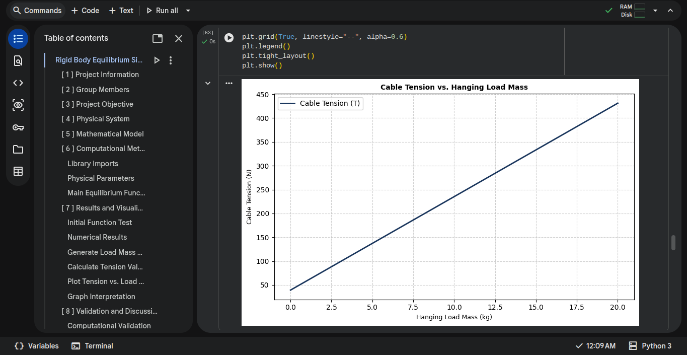
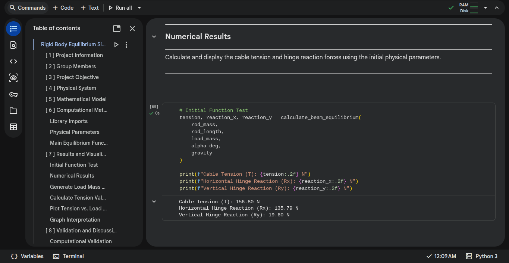

# Rigid-Body-Equilibrium-Simulator

[](https://colab.research.google.com/github/Saridi-The-Pro/Rigid-Body-Equilibrium-Simulator/blob/main/notebooks/rigid_body_equilibrium.ipynb)

A Python-based simulator for analyzing rigid body equilibrium using numerical calculations and graphical visualization with NumPy and Matplotlib.

## Project Background

Rigid Body Equilibrium Simulator originated as a Grade XI computational physics project at **IPEKA Palembang Christian School**, focused on the study of rigid body equilibrium.

The project was developed to translate the analytical physics model of a hinged support rod into a Python-based computational program, using numerical calculations and graphical visualization.

What began as an academic assignment is being developed further into an open-source project. Following the completion of its initial academic implementation, further development is currently on hold, with the goal of making the project accessible for learning, experimentation, and future development.

## AI Assistance

AI tools, including ChatGPT, were used throughout the development process to assist with project planning, code implementation, technical explanations, and debugging.

The project direction, requirements, and development decisions were guided by the human contributors. AI-generated code and suggestions are evaluated and tested as part of the development process.

## Current Version

v0.1.0 - Initial Computational Model & Visualization

## Screenshots

### Simulation Graph


### Computational Results


## Current Features

- **Rigid Body Equilibrium Calculation** — Calculates cable tension and horizontal and vertical hinge reactions.
- **Modular Python Function** — Uses a reusable function to perform equilibrium calculations.
- **Input Validation** — Validates numerical inputs, finite values, and physical parameter ranges.
- **Parameter Recalculation** — Recalculates equilibrium forces after physical parameters are updated and the relevant notebook cells are executed.
- **Graphical Visualization** — Generates a Matplotlib graph showing cable tension against hanging load mass.
- **Parameter Testing** — Allows users to investigate how different physical parameters affect equilibrium forces.
- **Computational Validation** — Compares computational results with analytical calculations.

## Planned Features

No planned features at the moment.

## Dependencies

This project requires Python and the following libraries:

- NumPy
- Matplotlib

Install the required dependencies using pip:

```bash
python -m pip install -r requirements.txt
```

## How to Run the Program

This project uses Google Colab to run the simulation through an interactive Jupyter Notebook.

### Using Google Colab

1. Open the project notebook: [`rigid_body_equilibrium.ipynb`](notebooks/rigid_body_equilibrium.ipynb).
2. Click the **Open in Colab** badge or open the notebook directly in Google Colab.
3. Once the notebook is loaded, select **Runtime → Run all**.
4. Wait for all cells to finish executing.
5. Modify the physical parameters in the `PHYSICAL PARAMETERS` section to experiment with different conditions.
6. Run the notebook again to update the computational results and graphical visualization.

### Running Locally (Optional)

The notebook can also be downloaded and executed in a local Jupyter environment.

Install the required dependencies:

```bash
python -m pip install -r requirements.txt
```

Open the notebook using Jupyter Notebook or JupyterLab and execute its cells.

## Authors

- Jeremy Sebastian Edward Limasnsantoso
- Saridi

## Copyright

Copyright (c) 2026  
Jeremy Sebastian Edward Limasnsantoso and Saridi

## License

This project is licensed under the Apache License 2.0.  
See the LICENSE file for details.
